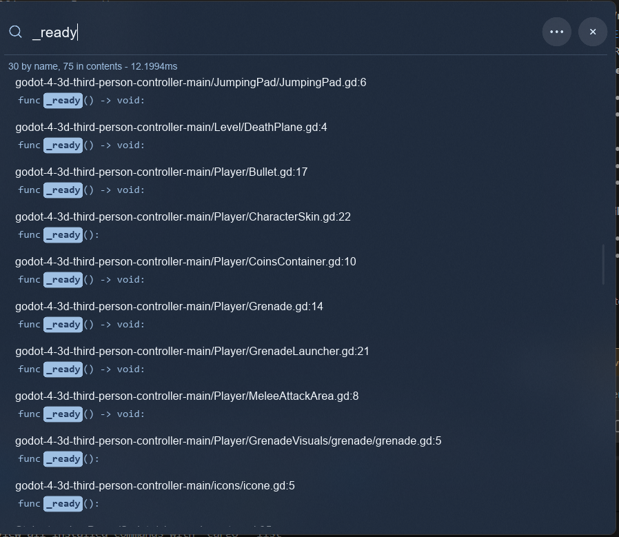

<p align="center">
  
</p>

<h1 align="center">wff (W Fuzzy Finder)</h1>

<p align="center">Lightweight Fuzzy File Finder for Windows</p>

Built with Rust and [Slint](https://slint.dev) on top of [fff-search](https://crates.io/crates/fff-search).

<p align="center">
  
</p>

## Build

Requires Rust 1.85 or newer and Windows 10 or 11.

```
cargo build --release
```

The executable is `target\release\wff.exe`. It has no console window.

## Use

Start it with a folder, or pick one from the window:

```
wff .
wff D:\projects\app
```

Type to search

### Open-with rules

Rules are edited in the settings view (the ⋯ button) and stored in `%APPDATA%\wff\config.json`.
A rule maps an extension to a command. `{path}`, `{line}` and `{col}` are replaced before it runs. The program starts directly; `.cmd` and `.bat` programs go through cmd.exe, and a command that is only a file, such as `{path}` on its own, opens it with its default application. The extension `*` matches everything.

```json
{
  "language": "en",
  "rules": [
    { "extension": "rs", "command": "code --goto {path}:{line}" },
    { "extension": "*", "command": "{path}" }
  ]
}
```

Presets are available for VS Code, Visual Studio, Notepad, Explorer and the default program.

### Windows integration

Both options write to the current user only, no administrator rights needed.

- **Right-click menu** registers `Search with wff` under `HKCU\Software\Classes\Directory\shell` for folders and folder backgrounds.
- **Terminal command** writes `%LOCALAPPDATA%\wff\bin\wff.cmd`, adds that folder to the user `PATH` and registers an App Paths entry. Open a new terminal after enabling it.

Both entries point at the running executable and are refreshed on every launch, so moving `wff.exe` is fine.
